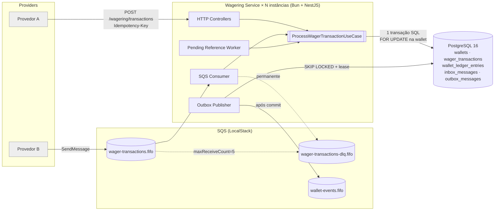
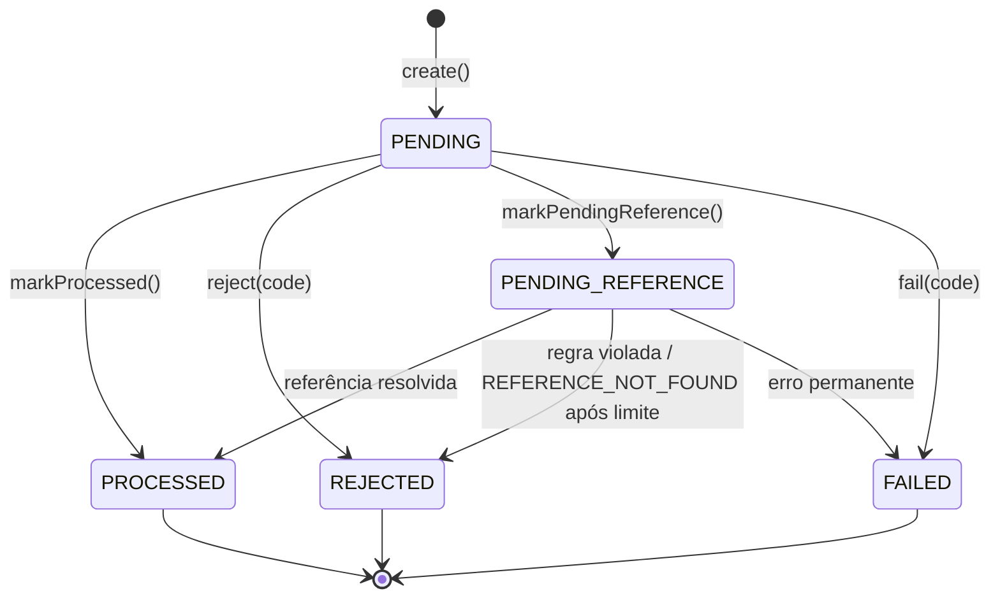

# ARCHITECTURE — Distributed Wagering Processor

> Documento vivo. As decisões ficam registradas como **Architecture Decision Records**
> no formato de Michael Nygard (2011) em [`docs/adr/`](docs/adr/). Este arquivo é o
> índice consolidado: visão geral, invariantes e onde cada uma é garantida, interpretações
> das regras de negócio e limitações conhecidas.

---

## 1. Propósito e drivers arquiteturais

Serviço financeiro que processa transações de apostas (`BET → WIN | LOSS | REFUND |
ROLLBACK`) vindas de múltiplos provedores por **HTTP** e **SQS FIFO**, com entrega
**at-least-once**, **fora de ordem** e **simultânea** em **≥ 3 instâncias**.

Drivers, em ordem de prioridade (derivados de §1, §3, §5 e §14 do `CHALLENGE.md`):

1. **Correção financeira** — nunca duplicar crédito/débito, nunca saldo negativo, ledger
   imutável e reconciliável.
2. **Correção sob concorrência real** — múltiplas instâncias, hot wallet.
3. **Idempotência persistente** — replay fiel, conflito explícito.
4. **Sem perda de eventos confirmados** — e sem eventos de fatos não confirmados.
5. **Simplicidade explicável** — o banco é a fonte da verdade; o broker é otimização.

## 2. Visão de alto nível



### Camadas e regra de dependência (Hexagonal / Ports & Adapters)

```text
interfaces (HTTP, SQS consumer, workers)  ─┐
infrastructure (MikroORM, SQS, logs, métricas, auth adapters) ─┤──► application (use cases, ports) ──► domain
```

| Camada | Conteúdo | Pode depender de |
|---|---|---|
| `domain` | `Money`, `Wallet`, `WagerTransaction`, `WalletLedgerEntry`, `InboxMessage`, `OutboxMessage`, `IntegrationEvent` e subclasses, erros de domínio, `FailureCode` | nada (TypeScript puro) |
| `application` | use cases, portas (`UnitOfWork`, repositórios, `Clock`, `IdGenerator`, `PayloadHasher`, `MessagePublisher`, `Metrics`, `ProviderIdentityPort`) | `domain` |
| `infrastructure` | adapters MikroORM (`EntitySchema` + mappers), SQS, pino, métricas, auth no-op | `application`, `domain` |
| `interfaces` | controllers NestJS, DTOs, filtros de exceção, consumer, workers | `application` |

## 3. Índice de ADRs

| # | Decisão | Status | Áreas do §14 |
|---|---|---|---|
| [ADR-001](docs/adr/0001-money-value-object.md) | Precisão monetária e imutabilidade via Value Object `Money` (`bigint` em centavos, string decimal na fronteira, `NUMERIC(19,2)` no banco) | Aceita | Correção financeira |
| [ADR-002](docs/adr/0002-pessimistic-lock-per-wallet.md) | Concorrência confinada à `walletId` via `SELECT … FOR UPDATE` + defesa em profundidade no schema | Aceita | Concorrência |
| [ADR-003](docs/adr/0003-persistent-idempotency-canonical-hash.md) | Idempotência persistente com hash canônico SHA-256 e mapeamento HTTP replay × conflito | Aceita | Idempotência |
| [ADR-004](docs/adr/0004-transactional-outbox-and-inbox.md) | Transactional Outbox + Inbox numa única transação SQL; publicação ordenada por wallet (claim da cabeça + lease, `SKIP LOCKED`) | Aceita | Mensageria e falhas |
| [ADR-005](docs/adr/0005-mikro-orm.md) | MikroORM 7.x: `EntitySchema`, mappers para `rehydrate`, `fork` + `transactional`, migrations SQL reversíveis em lista explícita | Aceita | Modelagem e arquitetura |
| [ADR-006](docs/adr/0006-decoupled-authentication.md) | Autenticação desacoplada via `ProviderIdentityPort` + guard no-op (desenho alvo: Keycloak client credentials) | Aceita | — (§2) |
| [ADR-011](docs/adr/0011-bounded-retention-inbox-outbox.md) | Retenção limitada de inbox (7 d) e outbox publicada (72 h) em lotes com `SKIP LOCKED`; pendentes nunca apagados | Aceita | Mensageria e falhas |
| [ADR-012](docs/adr/0012-periodic-reconciliation-detect-not-correct.md) | Reconciliação periódica de todas as wallets em snapshot `REPEATABLE READ`, uma instância por vez (advisory lock); detecta e não corrige | Aceita | Correção financeira, Observabilidade |
| [ADR-013](docs/adr/0013-spec-first-openapi-contract.md) | Contrato OpenAPI 3.1 *spec-first* com teste de paridade rotas × spec | **Proposta** | Documentação |

**Backlog de ADRs** (números reservados; serão registrados conforme a implementação
avançar):

| # | Tema |
|---|---|
| ADR-007 | Taxonomia de `failureCode` (formaliza a §6 deste documento) |
| ADR-008 | Política de referências fora de ordem: backoff, limite e TTL |
| ADR-009 | Observabilidade: logs estruturados, catálogo de métricas, health checks |
| ADR-010 | Estratégia de testes multi-processo e injeção de falhas |

Template para novos registros: [`docs/adr/template.md`](docs/adr/template.md).
ADRs aceitos não são editados no mérito; uma mudança de decisão gera um novo ADR que
**substitui** o anterior (status `Substituída por ADR-NNN`). As revisões de 2026-10-20
nos ADRs 002–005 foram feitas **antes de qualquer código** e estão registradas no
cabeçalho de cada um.

## 4. Invariantes e onde são garantidas

Cada invariante do edital tem **pelo menos duas camadas** de proteção: domínio (falha
rápida, mensagem clara) e schema (garantia final, §5.9).

| Invariante (edital) | Domínio | Banco (schema) | ADR |
|---|---|---|---|
| Dinheiro nunca é `number` (§5.1) | `Money` em `bigint`; `Money.from` só aceita string | `NUMERIC(19,2)`; sem *type parser* float | 001 |
| Moeda da operação = moeda da wallet (§6.2) | `Wallet.assertSameCurrency`, `Money.assertSameCurrency` | FK composta `ledger(wallet_id, currency) → wallets(id, currency)` | 001 |
| Uma wallet por `playerId + currency` (§6.2) | — | `UNIQUE (player_id, currency)` | 002 |
| Saldo nunca negativo (§3, §6.2) | `Wallet.debit` rejeita | `CHECK (balance_amount >= 0)`, `CHECK (balance_after >= 0)` | 002 |
| Sem lost update (§5.7, §6.2) | — | `FOR UPDATE`; `UNIQUE (wallet_id, wallet_version)` no ledger; `UPDATE … WHERE version = ?` | 002 |
| `version` inicia em 1 e só muda com o saldo (§6.2) | `Wallet` incrementa apenas em `debit`/`credit` | `CHECK (version >= 1)`; trigger diferido saldo ↔ ledger | 002 |
| Toda alteração de saldo tem lançamento e vice-versa (§6.2) | `debit`/`credit` retornam o `WalletLedgerEntry` | *constraint trigger* `DEFERRABLE INITIALLY DEFERRED` | 002 |
| Lançamento aritmeticamente correto (§6.4) | `WalletLedgerEntry.create` valida `isBalanced()` | `CHECK (balance_after = balance_before ± amount)` | 002 |
| Corrente do ledger contínua (sem buracos nem saldo anterior forjado) | `Wallet` cria o lançamento a partir do próprio saldo | trigger `BEFORE INSERT ledger_assert_chain`: `balance_before` = `balance_after` anterior e `wallet_version` = anterior + 1 | 002 |
| Ledger imutável (§5.5, §6.4) | classe sem setters nem transições | trigger `BEFORE UPDATE OR DELETE` → `RAISE`; `REVOKE UPDATE, DELETE, TRUNCATE` | 002 |
| ≤ 1 lançamento por transação/wallet (§6.4) | — | `UNIQUE (transaction_id)` | 002 |
| Idempotency key única; mesma key + payload diferente = conflito (§6.3, §9) | `matchesPayload(hash)` | `UNIQUE (provider_id, idempotency_key)`, `UNIQUE (provider_id, external_transaction_id)` | 003 |
| Estados terminais não mudam (§6.3) | transições lançam `InvalidTransactionStateError` | trigger `BEFORE UPDATE` bloqueia mudança a partir de terminal | 003 |
| REFUND/ROLLBACK exigem referência (§7.1) | `requiresReference()` em `create` | `CHECK (kind NOT IN ('REFUND','ROLLBACK') OR reference_external_transaction_id IS NOT NULL)` | 003 |
| Referência revertida no máximo uma vez (§7.4) | validação no use case | índice único parcial `(reference_transaction_id) WHERE status='PROCESSED' AND kind IN ('REFUND','ROLLBACK')` | 002/003 |
| `OPENING` é interno (§6.3) | DTO/consumer rejeitam | `UNIQUE (wallet_id) WHERE kind='OPENING'` | — |
| Inbox, saldo, ledger e outbox atômicos (§6.5, §11) | — | transação única; PK `(consumer_name, message_id)` | 004 |
| Evento nunca antes do commit (§5.4) | eventos só vão à outbox | outbox na mesma transação; publisher só lê linhas comitadas | 004 |
| Sem lock global (§5.6) | — | lock por linha de wallet | 002 |
| Correto com N instâncias (§5.8) | nenhum estado de coordenação em memória | locks, unicidade e inbox no PostgreSQL | 002–004 |

## 5. Interpretações adotadas das regras de negócio

O edital pede que interpretações adicionais sejam documentadas (§7):

1. **Reversão exclusiva.** "Uma referência não pode ser revertida duas vezes pelo mesmo
   tipo de operação" (§7.4) é aplicado de forma **mais estrita**: uma transação é
   revertida **no máximo uma vez no total** por `REFUND` **ou** `ROLLBACK`. Permitir
   `REFUND` + `ROLLBACK` da mesma `BET` creditaria o valor duas vezes, violando a
   invariante global de §3. Reverter a própria reversão continua possível
   (`ROLLBACK` de um `REFUND`).
2. **`WIN` com referência opcional.** Se informada, a referência deve ser uma `BET`
   `PROCESSED` da mesma rodada/wallet; se ausente, o `WIN` é aceito sem vínculo. `WIN`
   não "consome" a `BET` (não é reversão).
3. **Valores.** `BET`, `WIN`, `REFUND`, `ROLLBACK` e `OPENING` exigem `amount > 0`;
   `LOSS` aceita `amount >= 0` (informativo, sem efeito no saldo). Schema:
   `CHECK (amount > 0 OR kind = 'LOSS')`.
4. **`LOSS`** vira `PROCESSED`, publica `WagerTransactionProcessed`, **não** gera ledger,
   **não** incrementa `version` e **não** publica `WalletBalanceChanged`.
5. **Wallet inexistente** é erro de contrato (HTTP `404`, SQS → DLQ), **não** persistido
   como `REJECTED`: não há wallet a que a transação pertença (FK).
6. **Moeda/player divergentes** são rejeições de negócio **persistidas** (`REJECTED`),
   para que o replay seja fiel. Por isso `wager_transactions` não tem FK composta de
   moeda/player — apenas o ledger tem.
7. **Normalização de valor**: `"25"` e `"25.00"` são o mesmo payload para fins de hash.
8. **`PENDING` não é persistido** no fluxo síncrono: a transação nasce `PENDING` em
   memória e transita antes do commit para `PROCESSED`, `REJECTED` ou `PENDING_REFERENCE`.
9. **`FAILED`** é reservado a erro permanente não-negocial detectado sobre uma transação
   já persistida (ex.: falha irrecuperável no reprocessamento de `PENDING_REFERENCE`).

### Máquina de estados de `WagerTransaction`



## 6. Taxonomia preliminar de `failureCode`

Formalizada no futuro ADR-007. Códigos estáveis, `SCREAMING_SNAKE_CASE`, legíveis por
máquina.

| Código | Quando | Provedor deve |
|---|---|---|
| `INSUFFICIENT_FUNDS` | `BET` maior que o saldo | não reenviar igual |
| `REVERSAL_INSUFFICIENT_FUNDS` | `ROLLBACK` de crédito deixaria saldo negativo (§7.9) | escalar operacionalmente |
| `CURRENCY_MISMATCH` | moeda ≠ moeda da wallet | corrigir payload |
| `WALLET_PLAYER_MISMATCH` | `playerId` ≠ dono da wallet | corrigir payload |
| `REFERENCE_NOT_FOUND` | referência não chegou dentro do limite (§7.1) | investigar |
| `REFERENCE_SCOPE_MISMATCH` | referência de outro provider/player/wallet/moeda/rodada | corrigir payload |
| `REFERENCE_KIND_NOT_ALLOWED` | `REFUND` de não-`BET`; `ROLLBACK` de `LOSS`/`ROLLBACK`/`OPENING` | corrigir payload |
| `REFERENCE_NOT_PROCESSED` | referência existe mas não está `PROCESSED` | investigar |
| `REFERENCE_ALREADY_REVERSED` | referência já revertida | não reenviar |
| `AMOUNT_MISMATCH` | valor ≠ valor da referência (§7.5) | corrigir payload |

Erros de contrato (não persistidos) usam `code` na resposta HTTP: `VALIDATION_ERROR`,
`WALLET_NOT_FOUND`, `IDEMPOTENCY_KEY_REUSED`, `EXTERNAL_TRANSACTION_ID_REUSED`,
`TRANSIENT_FAILURE` (ver ADR-003 §5).

## 7. Rastreabilidade com a matriz de avaliação (§14)

| Área (pts) | Onde é atendida |
|---|---|
| Correção financeira (20) | ADR-001; §4 e §5 deste documento; reconciliação (Plano, Passo 5) |
| Concorrência (20) | ADR-002; testes multi-processo (Plano, Passo 6) |
| Idempotência (15) | ADR-003; teste 50× paralelo |
| Mensageria e falhas (15) | ADR-004; matriz de recuperação; testes de crash |
| Modelagem e arquitetura (10) | Camadas (§2), ADR-005, invariantes encapsuladas (§4) |
| Testes (10) | Plano, Passos 1–6 (unidade, integração real, concorrência real) |
| Observabilidade (5) | Plano, Passos 4–5; futuro ADR-009 |
| Documentação (5) | Este documento, ADRs, `README.md` |

## 8. Limitações conhecidas (consolidado)

- Escala monetária fixa em 2 casas para todas as moedas (ADR-001).
- Throughput serial por wallet; wallets "da casa" compartilhadas seriam gargalo (ADR-002).
- Idempotency keys sem expiração/arquivamento (ADR-003).
- Publicação de eventos at-least-once (ordenada por wallet); um evento que falha
  repetidamente bloqueia os seguintes da mesma wallet (ADR-004).
- Retenção de inbox (7 d) e outbox publicada (72 h); histórico de eventos além disso
  fica com os consumidores (ADR-011).
- Reconciliação periódica linear no tamanho do ledger (ADR-012).
- Entrada de `amount` aceita 0–2 casas (padrão de mercado); leitura estrita do edital é
  um risco assumido e documentado (ADR-001).
- Risco de compatibilidade Bun × MikroORM mitigado por smoke test e fallback (ADR-005).
- API sem autenticação/autorização e sem rate limiting (ADR-006).
- Ledger de partida simples (double-entry é diferencial opcional, não adotado).
