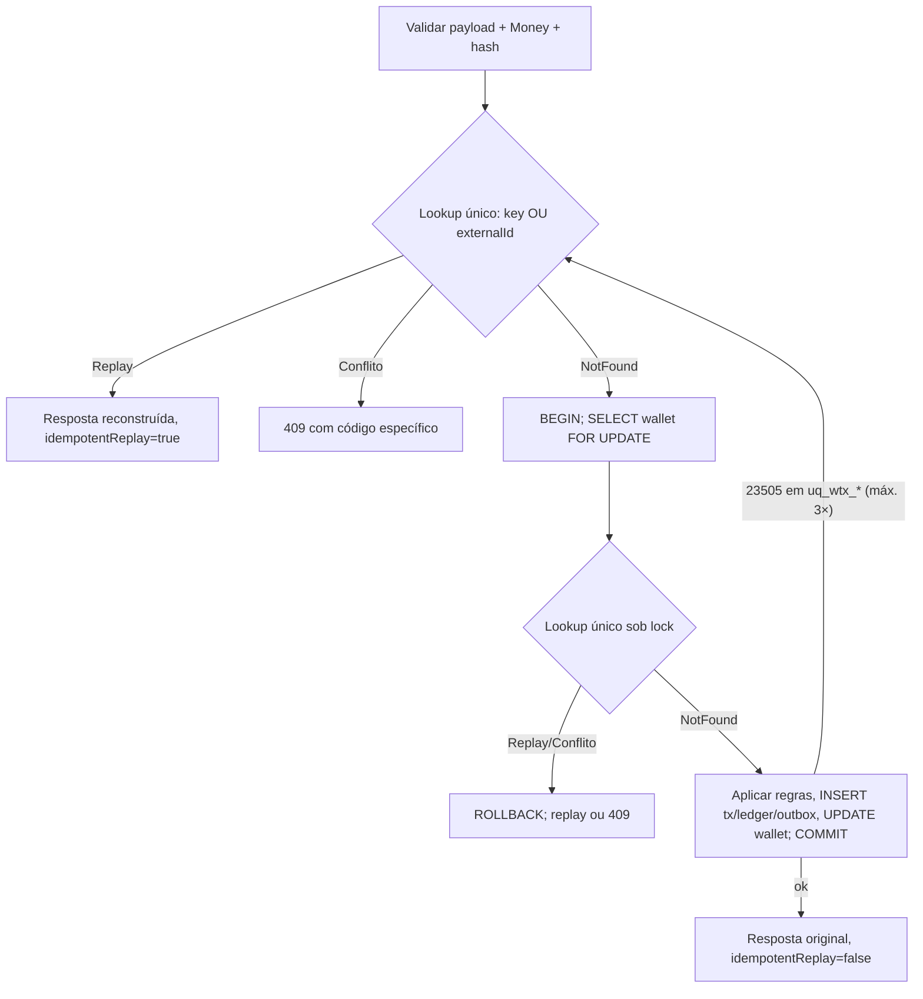

# ADR-003 — Idempotência persistente com hash canônico SHA-256

- **Status:** Aceita
- **Data:** 2026-10-20
- **Revisão:** 2026-10-20 — busca de idempotência unificada em consulta única (key **ou** id externo), após análise comparativa com implementação de referência
- **Relacionados:** ADR-001, ADR-002, ADR-004
- **Edital:** §3, §5.2, §6.3, §7 (regra 7), §9 (Idempotência, Status HTTP), §10, §13 (Unidade; Concorrência 1), §14 (Idempotência — 15 pts; eliminatória "idempotência apenas em memória")

---

## Contexto

A entrega é **at-least-once** (§3): a mesma operação chega várias vezes, por HTTP e/ou
SQS, possivelmente ao mesmo tempo em instâncias diferentes. Requisitos:

- `Idempotency-Key` é obrigatório e é **a fonte da verdade** (§9);
- requisição idêntica → **mesma resposta**, com `idempotentReplay: true`, incluindo o
  **saldo observado no momento original** (§7.7);
- mesma key com payload diferente → **conflito**, não replay (§6.3, §9);
- `payloadHash` = hash de **JSON canônico** (chaves ordenadas) do subconjunto de campos
  de negócio; header e metadados de transporte ficam fora; algoritmo documentado;
- cache em memória **não** pode ser a garantia (§5.2, eliminatório);
- teste obrigatório: a mesma aposta **50× em paralelo** → um único débito.

Riscos:

1. **Check-then-act**: "procura a key; se não existe, processa" sofre race entre
   instâncias — dois processos não encontram e ambos debitam.
2. **Formatação ≠ semântica**: `"25"` e `"25.00"` ou ordem diferente de chaves não
   podem gerar hashes distintos (falso conflito), mas `"provider-a"` vs `"Provider-A"`
   **são** identidades distintas.
3. **Replay precisa ser fiel**: devolver o saldo *atual* em vez do saldo daquele momento
   viola §7.7.
4. **Duas chaves de unicidade de negócio**: a idempotency key e o par
   `(providerId, externalTransactionId)`. Um provedor pode reenviar o mesmo
   `externalTransactionId` com outra key.
5. O provedor decide reenviar com base no **status HTTP**; colapsar conflito, rejeição
   e falha transitória no mesmo código o força a interpretar mensagens.

## Decisão

### 1. A própria `wager_transactions` é o registro de idempotência

Não criamos uma tabela genérica de "respostas". A transação persistida contém tudo o
que é necessário para reconstruir **deterministicamente** a resposta original:

| Coluna | Papel |
|---|---|
| `idempotency_key` | key recebida (header HTTP ou `data.idempotencyKey` no SQS) |
| `payload_hash` `CHAR(64)` + `payload_hash_version SMALLINT` | hash canônico e versão do algoritmo |
| `status`, `failure_code` | resultado |
| `result_balance_amount` `NUMERIC(19,2)` | **snapshot do saldo observado** ao decidir (após aplicar, ou o saldo vigente ao rejeitar) |

Constraints:

```sql
CONSTRAINT uq_wtx_provider_idempotency UNIQUE (provider_id, idempotency_key),
CONSTRAINT uq_wtx_provider_external    UNIQUE (provider_id, external_transaction_id)
```

A key é escopada por `provider_id` para que provedores diferentes não colidam (e,
quando houver autenticação — ADR-006 — o `provider_id` virá da identidade autenticada).

### 2. Algoritmo de hash canônico (`payload_hash_version = 1`)

1. Parse e validação do payload; `money` passa por `Money.from` (ADR-001) e é
   **normalizado** para escala 2.
2. Monta-se o objeto de negócio com **exatamente** estes campos:
   `providerId`, `externalTransactionId`, `playerId`, `walletId`, `roundId`, `gameId`,
   `kind`, `money.amount` (normalizado), `money.currency`,
   `referenceExternalTransactionId` (**omitido** quando ausente; `null` ≡ ausente).
3. Excluídos: `Idempotency-Key`, `messageId`, `type`, `occurredAt`, `correlationId`,
   headers e qualquer campo desconhecido (rejeitado na validação, não ignorado).
4. Serialização canônica (subconjunto da RFC 8785 / JCS): chaves ordenadas
   lexicograficamente por unidade de código UTF-16 **em todos os níveis**, sem espaços,
   strings com escaping JSON padrão. Todos os valores são strings → não há ambiguidade
   de canonicalização numérica.
5. Strings são comparadas **byte a byte**: sem `trim`, sem *case folding* (IDs são
   opacos; transformá-los seria mascarar erro do provedor).
6. `SHA-256` sobre os bytes UTF-8 → hex minúsculo (64 chars).

```text
{"externalTransactionId":"transaction-123","gameId":"fortune-chimp","kind":"BET",
 "money":{"amount":"25.00","currency":"BRL"},"playerId":"0192f28f-...","providerId":"provider-a",
 "roundId":"round-987","walletId":"0192f291-..."}            → sha256 → 64 hex
```

HTTP e SQS produzem **o mesmo hash** para a mesma operação — são canais
intercambiáveis: uma operação enviada por HTTP e depois por SQS com a mesma key é replay.

### 3. Fluxo à prova de race

Toda verificação de idempotência usa **uma única consulta** que cobre as duas chaves de
unicidade de negócio:

```sql
SELECT * FROM wager_transactions
WHERE provider_id = $1
  AND (idempotency_key = $2 OR external_transaction_id = $3);   -- ambos indexados (UNIQUE)
```

Classificação do resultado (`IdempotencyLookup`):

| Linhas encontradas | Resultado |
|---|---|
| nenhuma | `NotFound` → processar |
| uma, mesma key **e** mesmo hash | `Replay` (o hash inclui `externalTransactionId`, então o id externo também coincide) |
| uma, mesma key, hash diferente | `409 IDEMPOTENCY_KEY_REUSED` |
| uma, key diferente (casou pelo id externo) | `409 EXTERNAL_TRANSACTION_ID_REUSED` |
| duas (key casa uma linha, id externo casa outra) | `409 IDEMPOTENCY_KEY_REUSED` |



- **Por que uma consulta só:** com duas buscas separadas (por key, depois por id
  externo), um commit concorrente **entre** elas produz falso conflito; e uma busca
  apenas pela key, após um `23505` em `uq_wtx_provider_external`, não encontraria nada
  e voltaria a processar — um laço. A consulta única, avaliada sobre um mesmo snapshot
  de statement, elimina os dois problemas.
- **Fast-path sem lock** responde replays sem tocar na wallet (barato para a tempestade
  de duplicatas).
- **Re-checagem sob lock**: duplicatas da mesma wallet são serializadas pelo lock do
  ADR-002; a segunda vê o commit da primeira.
- **Rede de segurança no schema**: se a mesma key chegar com `walletId` diferente
  (payload divergente → locks diferentes), as constraints `UNIQUE` disparam `23505`; o
  use case faz rollback e repete o lookup — que agora **encontra** a linha comitada e
  responde 409 ou replay. Limite de 3 repetições (`idempotency_retry_exhausted_total`
  → 503), que na prática nunca é atingido porque a linha conflitante já está comitada
  quando o `23505` é reportado.

### 4. Semântica de replay por status

| Status persistido | Replay devolve |
|---|---|
| `PROCESSED` | mesmo `transactionId`, `status`, `result_balance_amount` original |
| `REJECTED` | mesmo `failureCode` e saldo observado na rejeição |
| `PENDING_REFERENCE` | **estado atual** (pode ter evoluído para terminal) — não há "resultado original" enquanto não for terminal |
| `FAILED` | mesmo `failureCode` |

Replays **não** geram ledger, outbox nem métricas de status — apenas
`idempotency_replays_total` e, para conflitos, `idempotency_conflicts_total`.

### 5. Mapeamento HTTP (consistente em todos os endpoints)

| Situação | HTTP | Corpo | Provedor deve |
|---|---|---|---|
| Processada agora | `201` | `idempotentReplay:false` | — |
| Replay de processada | `200` | `idempotentReplay:true` | — |
| Rejeição de negócio (nova ou replay) | `422` | `status:"REJECTED"`, `failureCode` | não reenviar igual |
| Aceita, aguardando referência | `202` | `status:"PENDING_REFERENCE"` | consultar depois |
| Conflito de idempotência | `409` | `code: IDEMPOTENCY_KEY_REUSED \| EXTERNAL_TRANSACTION_ID_REUSED` | corrigir key/payload |
| Payload inválido / header ausente | `400` | `code: VALIDATION_ERROR`, `violations[]` | corrigir payload |
| Wallet inexistente | `404` | `code: WALLET_NOT_FOUND` | corrigir referência |
| Falha transitória (lock timeout, PG/SQS indisponível) | `503` + `Retry-After` | `code: TRANSIENT_FAILURE` | **reenviar com a mesma key** |

O `503` é seguro de re-tentar justamente porque a idempotência é persistente: ou a
transação foi confirmada (o retry vira replay), ou nada foi gravado.

### Alternativas consideradas

| Alternativa | Avaliação |
|---|---|
| Cache (memória/Redis) de keys | Rejeitada como garantia (§5.2); TTL e falha do cache reabrem a janela de duplicidade. |
| Tabela `idempotency_keys` genérica com resposta serializada (estilo Stripe) | Viável, mas duplica estado e exige manter os dois registros coerentes; a transação já é o fato de negócio. |
| Dedup do SQS FIFO (`MessageDeduplicationId`) | Janela de 5 min e só cobre a fila; é otimização (§5.3). |
| Hash do corpo bruto | Sensível a espaços/ordem de chaves/formatação do valor → falsos conflitos. |
| HMAC em vez de SHA-256 | Não há segredo a proteger: o hash é para comparação de integridade, não autenticação. |
| `409` para replay | Obrigaria o provedor a distinguir replay de conflito pela mensagem — exatamente o que §9 pede para evitar. |

## Consequências e Trade-offs

### Ganhos

- **Unicidade garantida pelo schema**, independente do número de instâncias ou canal.
- **Replays fiéis** (saldo da época) sem armazenar blobs de resposta.
- **Algoritmo versionado** (`payload_hash_version`): permite evoluir a canonicalização
  sem invalidar registros antigos.
- Status HTTP **acionáveis por máquina**: o provedor sabe se reenvia (503), corrige
  (400/409) ou desiste (422).

### Custos

- Duas buscas por índice único no caminho feliz (fast-path + re-check sob lock).
- Rejeições de negócio são **persistidas** (crescimento da tabela), necessário para replay
  fiel e auditoria.
- Normalizar `money` antes do hash significa que `"25"` e `"25.00"` são o mesmo
  payload — decisão consciente, documentada para os provedores.

### Limitações conhecidas

- Keys **não expiram**: retenção ilimitada na tabela de transações (é registro contábil;
  arquivamento seria um ADR futuro).
- Payloads inválidos (400) e wallet inexistente (404) **não** são persistidos — não há
  replay "registrado" para eles, apenas a mesma resposta por determinismo da validação.
- Sem autenticação (ADR-006), o `provider_id` do escopo vem do payload; a confiança
  nesse campo é a do canal.
