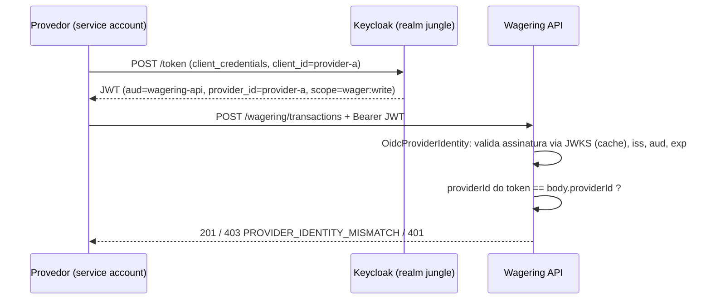

# ADR-006 — Autenticação desacoplada via `ProviderIdentityPort` e Guard no-op

- **Status:** Aceita
- **Data:** 2026-10-20
- **Relacionados:** ADR-003
- **Edital:** §2 (Autenticação — a cargo do candidato), §9 (health aberto), §10, §14 (autenticação não pontua)

---

## Contexto

§2 declara que autenticação **não vale pontos** e não deve competir com correção
financeira, concorrência e idempotência. Se implementada, deve integrar um IdP externo
(Keycloak, Zitadel), nunca autenticação artesanal. Se não implementada, é aceito desde
que: a decisão esteja documentada, o desenho alvo descrito e o **ponto de extensão
explícito no código** (`AuthGuard` no-op ou `ProviderIdentityPort`).

Escopo fixado pelo edital: health checks abertos; mensagens da fila são canal interno
confiável, **mas a identidade do provedor na mensagem continua sujeita às validações de
domínio**.

Forças:

- **Timebox**: subir e configurar Keycloak (realm, clients, rotação de chaves, testes)
  consome horas sem pontuação, aumentando o tempo de `docker compose up` e a superfície
  de falha nos testes de integração.
- **Risco de segurança real**: sem autenticação, qualquer cliente pode se passar por um
  provedor — inaceitável em produção, aceitável no desafio *se* o ponto de troca for
  trivial e não exigir refatorar o núcleo.
- O núcleo financeiro não deve saber **como** a identidade foi obtida, apenas **qual** é.

## Decisão

**Não implementar autenticação neste escopo**, deixando o ponto de extensão explícito e
o núcleo preparado.

### 1. Porta na camada de aplicação

```ts
export interface ProviderIdentity {
  readonly providerId: string;
  readonly authenticated: boolean;      // false no adapter no-op
  readonly scopes: readonly string[];
}

export interface ProviderIdentityPort {
  resolve(ctx: InboundContext): Promise<ProviderIdentity>;  // headers + payload
}
export const PROVIDER_IDENTITY_PORT = Symbol('ProviderIdentityPort');
```

### 2. Adapter atual: `TrustedPayloadProviderIdentity` (no-op)

Devolve `{ providerId: body.providerId, authenticated: false, scopes: ['*'] }`. Fica
registrado no módulo de auth; trocar por um adapter OIDC é **uma linha de binding**.

### 3. Guard global no-op + `@Public()`

- `ProviderAuthGuard` registrado como `APP_GUARD`, chama a porta e anexa a identidade à
  requisição; hoje sempre permite.
- `/health/live` e `/health/ready` são marcados com `@Public()` — continuarão abertos
  quando o guard for real.
- Log de inicialização em nível `warn`: `"auth disabled: TrustedPayloadProviderIdentity"`.

### 4. Validação de domínio independente de autenticação

Mesmo sem autenticação (HTTP) e com canal confiável (SQS), o use case valida:
`providerId` não vazio e não reservado (`internal` é usado por `OPENING`); `kind ≠
OPENING`; `wallet.playerId === payload.playerId` (`WALLET_PLAYER_MISMATCH`); referência
pertencente ao **mesmo provider**, player, wallet, moeda e rodada (§7.2). Quando a
identidade for autenticada, soma-se a regra `identity.providerId === payload.providerId`
→ caso contrário `403 PROVIDER_IDENTITY_MISMATCH`.

### 5. Desenho alvo (não implementado)



- **OAuth 2.0 Client Credentials**: um client por provedor (B2B, sem usuário humano);
  claim mapeada `provider_id`; escopos `wager:write`, `wallet:read`, `wallet:admin`.
- Validação local de JWT com `jose` e JWKS em cache (sem chamada ao IdP por requisição,
  preservando o ADR-002: nada de rede dentro da seção crítica).
- **JWKS inalcançável → `503 TRANSIENT_FAILURE`, não `401`**: falha do IdP é
  infraestrutura, não culpa do cliente; mantém a semântica de status do ADR-003 §5
  (o provedor sabe que pode reenviar).
- Escopo de idempotência (ADR-003) passa a usar o `providerId` **autenticado**.
- Alternativa equivalente: mTLS por provedor no gateway, com o CN do certificado mapeado
  para `providerId`.
- SQS: canal interno (IAM na AWS), sem token por mensagem.

## Consequências e Trade-offs

### Ganhos

- Timebox integralmente investido nas áreas que somam 100 pontos.
- `docker compose up` mais leve e testes de integração mais rápidos e determinísticos.
- Núcleo financeiro **agnóstico** ao mecanismo de identidade (Hexagonal); a troca é
  localizada em um adapter e um binding.

### Custos

- **API sem autenticação**: qualquer cliente com acesso de rede pode submeter transações
  em nome de qualquer provedor. Mitigação no desafio: execução local apenas.
- O guard no-op é código que existe "sem fazer nada" — precisa estar claramente
  sinalizado (log `warn` e este ADR) para não ser confundido com proteção.

### Limitações conhecidas

- Sem autorização por recurso (ex.: provedor A consultando wallet usada só por B).
- Sem rate limiting por provedor.
- A identidade do provedor no SQS é confiada ao payload (conforme §2).
